
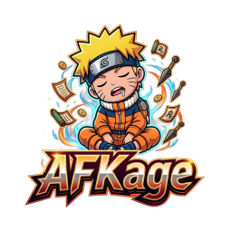

# AFKage — free auto-farm app for Naruto Blazing Revival

AFKage is a free Naruto Blazing app for Windows that auto farms Naruto Blazing Revival in BlueStacks.

Set up a To-Do list, press **Run** and go do something else. It farms Emergency Missions, Trials, Story and Ninja Road, clears your Daily Missions, waits out stamina, and carries on through the daily reset and maintenance. If it sees a screen it doesn't know, it stops without tapping and tells you why.

> AFKage is a free, unofficial fan tool. It is not made by or affiliated with the Naruto Blazing Revival team, Bandai Namco or GREE. It only reads screenshots of the game and taps through ADB, like a person would. It does not inject code, modify the game, read memory or need root. Use at your own risk and respect the revival's rules.

**[Download AFKage](../../releases/latest)** · [Report a bug](../../issues/new/choose) · [Get help or suggest something](../../discussions)

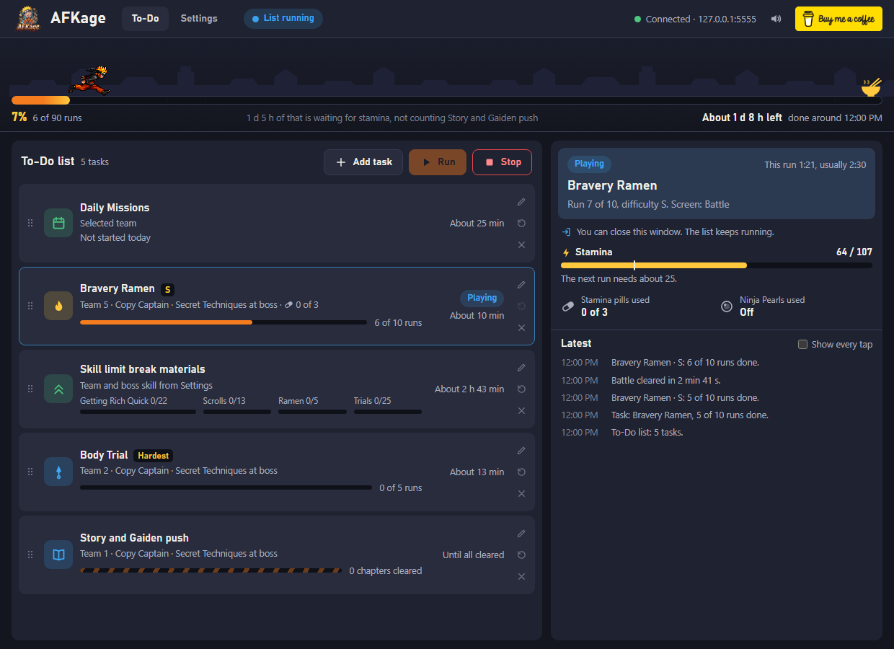

## Features

### To-Do list

- Tasks run from the top of the list down, and you can drag them into any order.
- Progress is saved after every run, so stopping or restarting loses nothing.
- Tasks that can't run yet are skipped, and they come back when they open. The time is shown on the task.
- A progress bar shows how much of the whole list is done, and when it should finish.

### Task types

- **Farm a stage:** Emergency Missions (Weekly, Impact and Event tabs), Trials, and Story Normal or Hard by number.
- **Limit Break:** farms one element's materials in order: Getting Rich Quick, Scrolls, Ramen, then Trials.
- **Story push:** clears everything not cleared yet: Story, Story Hard, Gaiden, then Gaiden Hard.
- **Daily:** the Daily Missions, once a game day.
- **Ninja Road:** plays the Road map by map with your three Ninja Road teams, a plan per map, Retreat and claim at the end, and the next Road after that. See [Ninja Road](#ninja-road).

### Task settings

- **Difficulty:** Hardest, Easiest, S, A, B or C. Hardest is the default.
- **Runs:** a number, or until you stop it.
- **Team:** 1 to 15, or Any for whichever team is selected in the game.
- **Copy Captain:** on or off.
- **Secret Techniques:** off, at boss, or all maps.
- **Ninjutsu:** off, at boss, or all maps.
- **Stamina pill cap and Ninja Pearl cap:** both start at 0, which means off.

### Daily Missions

- Reads the Daily list and only plays what isn't done.
- Plays the once-a-day stage and the Daily Trial you pick.
- Claims Accept All Rewards and the Present Box.
- Runs once per game day, then stays locked until the daily reset.

### Daily reset and maintenance

- **Daily reset (00:00 UTC):** taps through Data update, the title screen, Login Bonus and News, then carries on.
- **Maintenance:** closes and reopens the game every 15 minutes, for up to 2 hours.
- **The game closing:** opens it again, up to 3 times in a row.
- **A new game version:** stops and asks you to install it.

### Stamina

- With pills and pearls off, it waits on the main screen until there's enough stamina.
- Pills and pearls are used only when you turn them on, and never above your caps.
- Pills always go before pearls.
- If it doesn't know a stage's cost, it tries. If the game says there isn't enough stamina, it taps **No** and waits.

### Safety stops

- It only reads screenshots and taps through ADB.
- Every tap follows the same pattern: check the screen, tap, then check the result.
- On a screen it doesn't know, it stops without tapping, says why, and saves the screen for a bug report.
- It stops after 3 losses in a row. On Ninja Road, a wipe ends the Road and the next one starts; it stops when 3 Roads in a row are wiped before map 5.
- It stops if BlueStacks stops answering, or if a tap doesn't do what it should.

### Automatic updates

- AFKage looks for a new version each time it starts, and asks before installing it.
- New game data arrives by itself every few hours, and goes live between runs, never during a battle.
- Every update is signed, and AFKage refuses any that doesn't verify.

## Install on BlueStacks

You need Windows 10 or 11, and BlueStacks 5 with the game installed.

### Step 1: Set up BlueStacks

1. Open BlueStacks 5.
2. Open **Settings** (the gear icon).
3. Go to **Display**.
4. Choose **Portrait** and **900 x 1600**. AFKage only works at this size.
5. Press **Save changes**, and restart BlueStacks if it asks.
6. Go to **Advanced**.
7. Turn on **Android Debug Bridge (ADB)**.
8. Note the address under the switch, such as `127.0.0.1:5555`. You'll need it in Step 3.

### Step 2: Download AFKage

1. Open the [latest release](../../releases/latest).
2. Download `AFKage.exe`.
3. Put it somewhere you can write to, such as your Desktop or a folder of its own. It updates itself there.
4. Open it.
5. Windows may say it protected your PC, because AFKage isn't signed with a paid certificate. Press **More info**, then **Run anyway**.

### Step 3: First run

AFKage opens its own window and walks you through three steps. It doesn't tap anything in the game during setup. It also downloads its game data the first time, so it needs an internet connection.

**BlueStacks**

1. Paste the ADB address from Step 1.
2. Press **Check**.
3. If ADB is off or the size is wrong, AFKage says what to do. Fix that and press **Check** again.
4. Press **Next**.

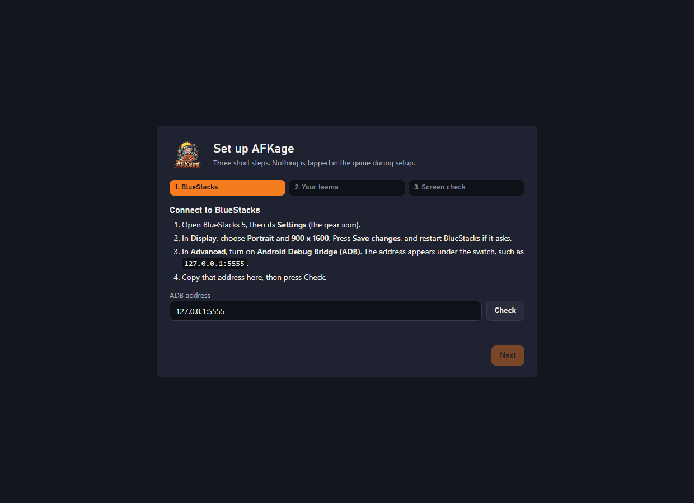

**Your teams**

1. Pick the team you use for each element, as numbered on the game's Select Team screen. Limit Break tasks and Getting Rich Quick use these.
2. Press **Next**.

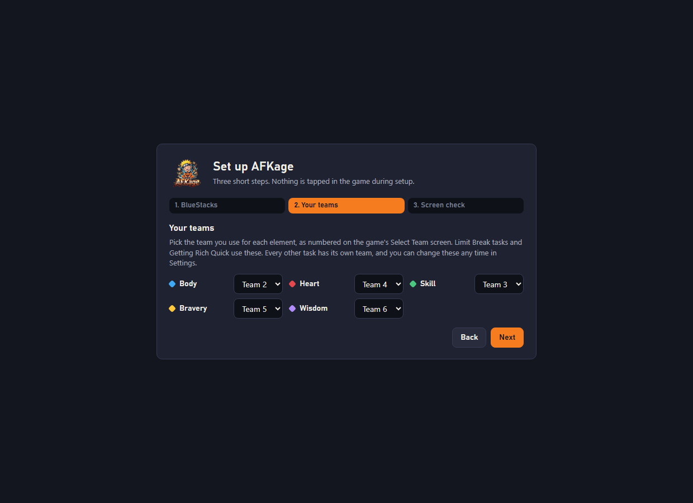

**Screen check**

1. Open the game's main screen in BlueStacks.
2. Press **Check screen**.
3. If AFKage recognises the screen, press **Finish**.
4. If it doesn't, your game may be a different version. Press **Save this screen**, then **Report a bug**. AFKage won't tap anything in the meantime.

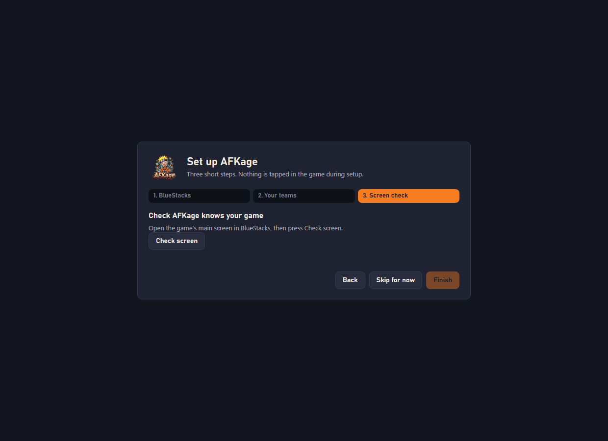

### Step 4: Your first task

1. Press **Add task**.
2. Pick a stage, a number of runs and a team.
3. Press **Add to list**.
4. Press **Run**.

## How to auto farm Naruto Blazing

### The To-Do tab

- **The left side** is your list. The pencil edits a task, the circular arrow resets its progress and the cross removes it. Drag the dots on the left to move a task.
- **Reset progress** asks first, then puts the task back to its start: a farm to 0 runs, a Story push to 0 chapters, a Limit Break's counts to 0, Ninja Road to Road 1 and its first map (the saved team looks are forgotten too), and the Daily to not started today, so it runs again (it still reads the mission list, so nothing that's already MAX is played again). The pills and pearls a task used stay counted. The task that's playing right now can't be reset: press **Stop** first.
- **The right side** shows what AFKage is doing now, your stamina, the pills and pearls used, and the latest steps. Tick **Show every tap** to see each one.
- **Finished** tasks move to the bottom of the list, with the time they ended.

### Adding tasks

Press **Add task** and choose a type. A new task starts with the settings you used last, except the pill and pearl caps, which always start at 0.

**Farm a stage**

Choose Emergency, Trials or Story. For Story, pick Normal or Hard and type the stage and chapter, like `20-3`.

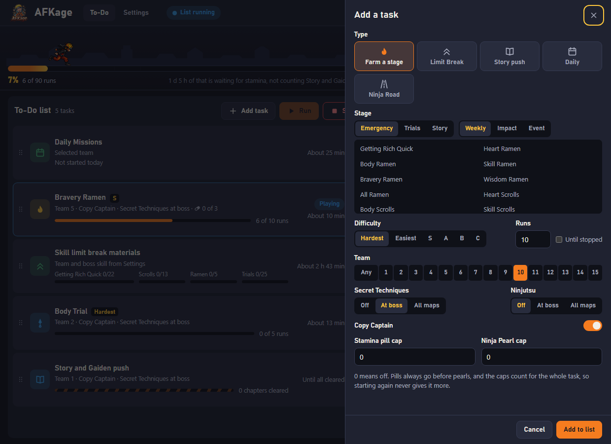

**Limit Break**

Choose an element. The team, Copy Captain and boss skill come from **Settings**, and it always plays the hardest difficulty shown. Tick **Start this element's counts again from 0** to start a new limit break.

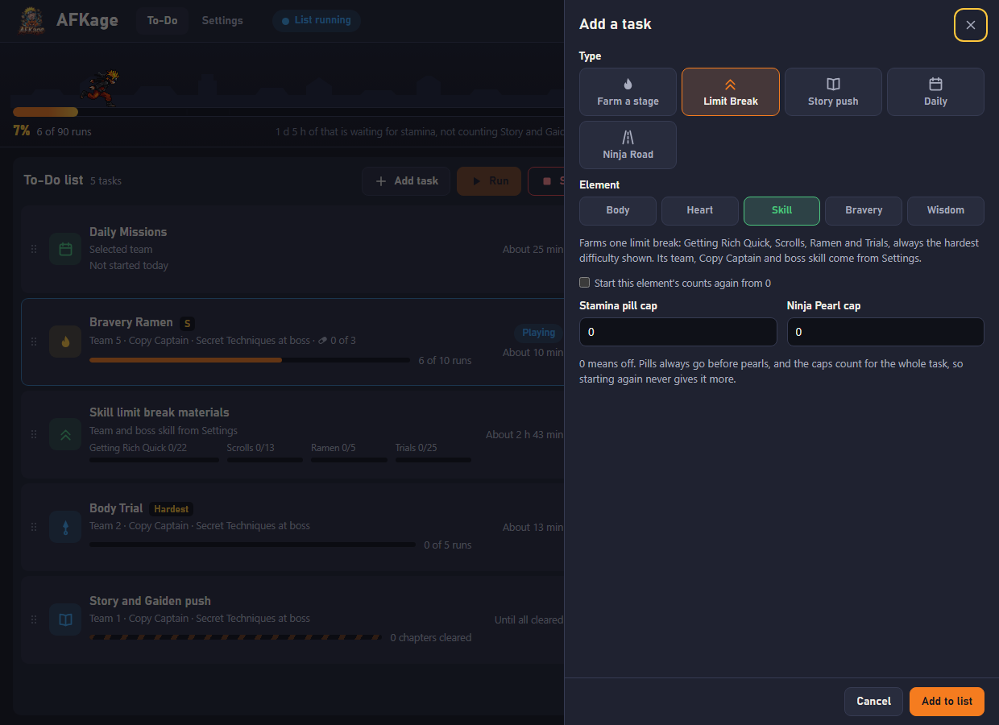

**Story push**

Pick the team and battle settings. It stops by itself when everything is cleared.

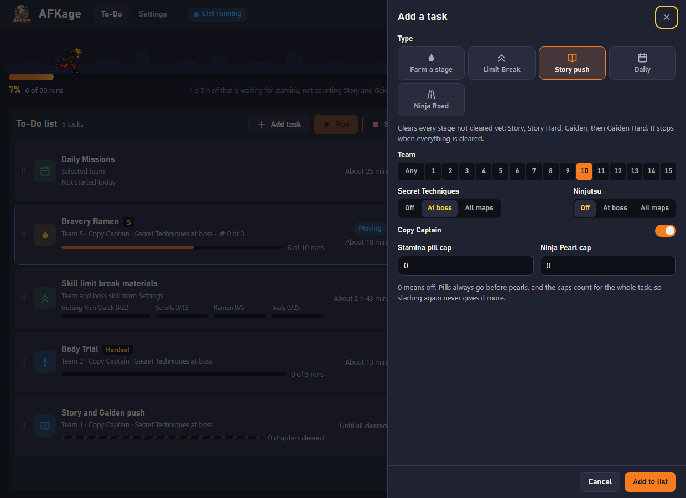

**Daily**

The Daily task goes to the top of the list. Emergency and Story runs always use Copy Captain, and the Trial uses the Daily Trial in **Settings**.

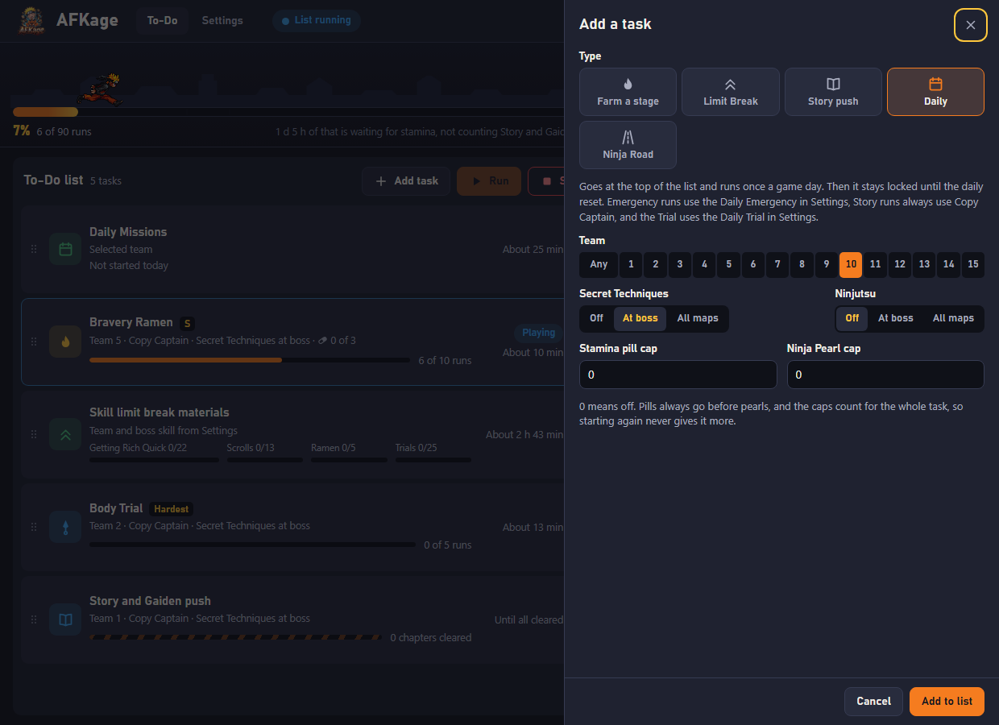

**Ninja Road**

See [Ninja Road](#ninja-road) below.

### Ninja Road

The Ninja Road task plays the Road map by map. Before every map it reads the map number on the Ready screen, swipes the team bar to the team your plan names, sets Auto, Ninjutsu and Secret Techniques the way the map's row says, and taps Ready!!. A wiped team is swapped for the next alive one. After the last map you asked for it retreats, claims the rewards, and starts the next Road if you asked for more.

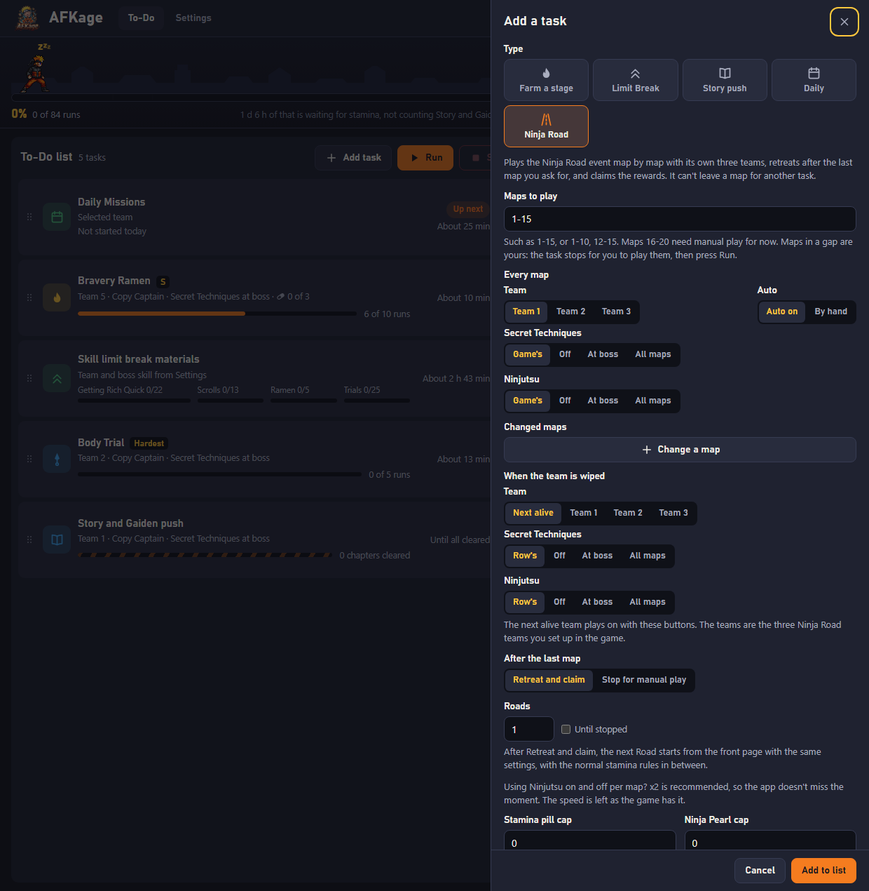

**Setting it up**

1. Press **Add task** and choose **Ninja Road**.
2. **Maps to play:** such as `1-15`. Maps in a gap, like `1-10, 12-15`, are yours: the task stops for you to play them, then press **Run**.
3. **Every map:** the row every map uses. **Team** 1, 2 or 3; **Auto** on, or by hand for a map you play yourself; **Secret Techniques** and **Ninjutsu** left as the game has them, off, at boss, or all maps.
4. **Changed maps:** press **Change a map**, type the map number, and set only what's different on that map. Anything left blank comes from the Every map row.
5. **When the team is wiped:** the team and buttons that take over for the rest of the Road once the row's team is gone. Leave the team blank for the next alive team in 1, 2, 3 order.
6. **After the last map:** **Retreat and claim**, or **Stop for manual play** if you want to carry on by hand.
7. **Roads:** a number, or tick **Until stopped**. Each new Road waits for stamina like any other task, and pills and pearls only go within the caps.
8. Press **Add to list**.

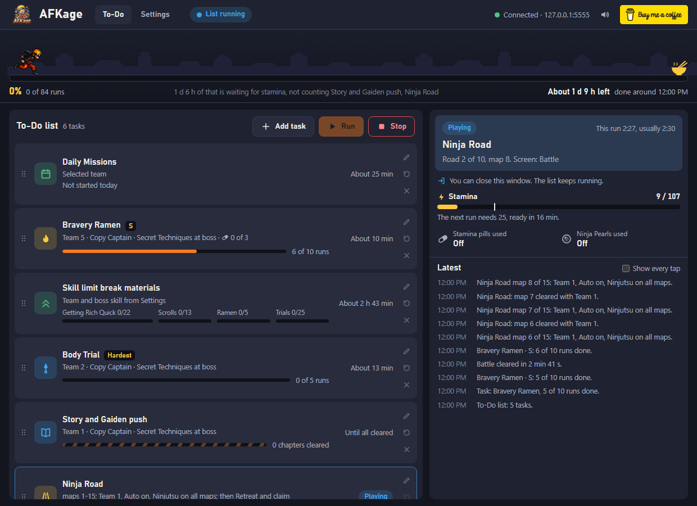

**How the teams work**

- The teams are the game's three Ninja Road teams, the ones Team Setup lists. There's nothing to set up in AFKage.
- A new Road opens on Team 1. At its first map AFKage swipes through the bar once and remembers each team by its faces, then finds the team each map wants by those faces, however the Road has gone. If two teams look the same it stops and says so.
- After a restart it matches the teams it remembered for that Road. If it can't, it asks you to swipe the bar to Team 1 and press **Run**.

**How a Road ends**

- After the last map you asked for, it taps **Retreat**, confirms, and taps through the results pages. The map rewards are kept.
- A wipe ends the Road too: it taps **OK** on "All teams defeated", claims the rewards from the maps it cleared, and logs how far it got, such as **Road 2 ended at map 13 (all teams wiped)**. If Roads remain, the next one starts.
- If 3 Roads in a row are wiped before map 5, it stops: "The team keeps losing early on Ninja Road. Check the team, then start again."
- The daily reset ends every Road. If a task was part way through one, the next time it opens Ninja Road it logs **The previous Road ended (probably the daily reset). Starting a new one**, and starts again from its first map.
- The card shows where it is and how the last Road ended, such as **Road 3 of 10 · last ended map 13 (wiped) · Map 1 of 15 · Team 1**.

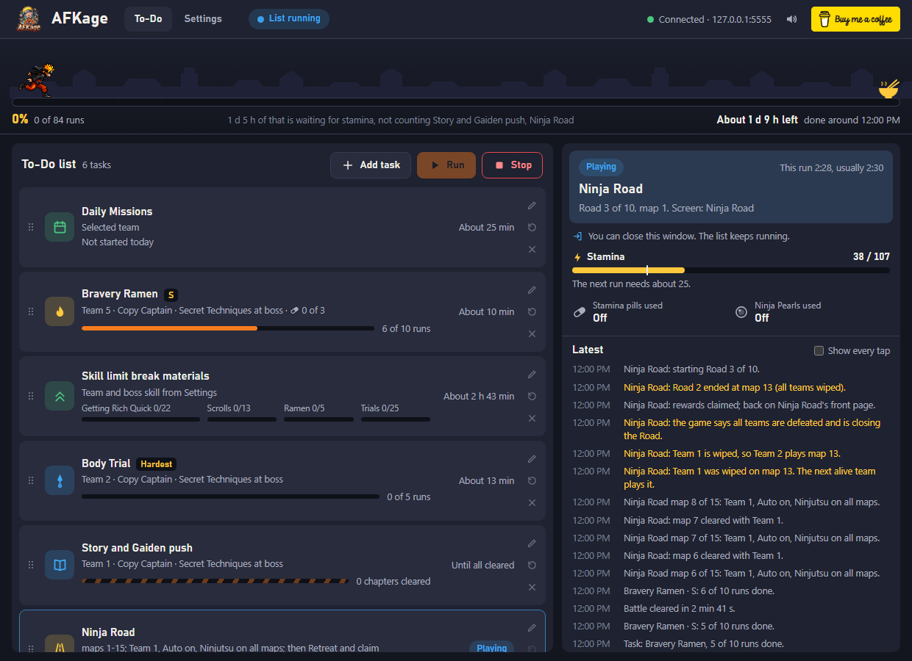

**A good setup to start with**

One strong team, **Auto** on, **Ninjutsu** on all maps, maps `1-15`, **Retreat and claim**, and **Until stopped**. The pictures above use that setup, with 10 Roads. Add changed maps once you know where that team needs Secret Techniques, or a different team.

**Maps 16 to 20** need manual play for now: the game's Auto doesn't get through them. Leave them out of the maps to play, or set **Stop for manual play** and finish the Road yourself. Playing them for you is on the [roadmap](#v2-custom-manual).

### Pill and pearl caps

- The caps are for the whole task, so starting the list again never gives it more.
- 0 means off.
- The right side of the window shows how many have been used.

### Run and Stop

- **Run** starts from the top of the list. Finished tasks are removed, and progress is saved.
- **Stop** finishes the battle under way, then stops. If AFKage is only waiting, it stops at once.
- **Stop now** appears after you press **Stop**. It stops at once, so that run won't count.

### Running in the background

- Closing the window only closes the screen. The list keeps farming through stamina waits, the daily reset and the Daily Missions.
- Open AFKage again to see it or stop it.
- BlueStacks must stay open and the PC awake.
- A PC restart stops the list. Progress is saved, so press **Run**.

### The progress bar

The bar shows the whole list's progress and its finish time, worked out from your real run times and 1 stamina a minute.

| Naruto | What it means |
| --- | --- |
| 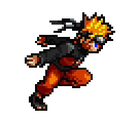 | Playing a battle. |
| 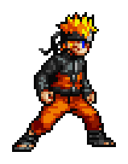 | Waiting or stopped, with a zzz above him. |

### Waiting for stamina

When there isn't enough stamina, the task shows **Waiting for stamina** and the right side says when it'll be back.

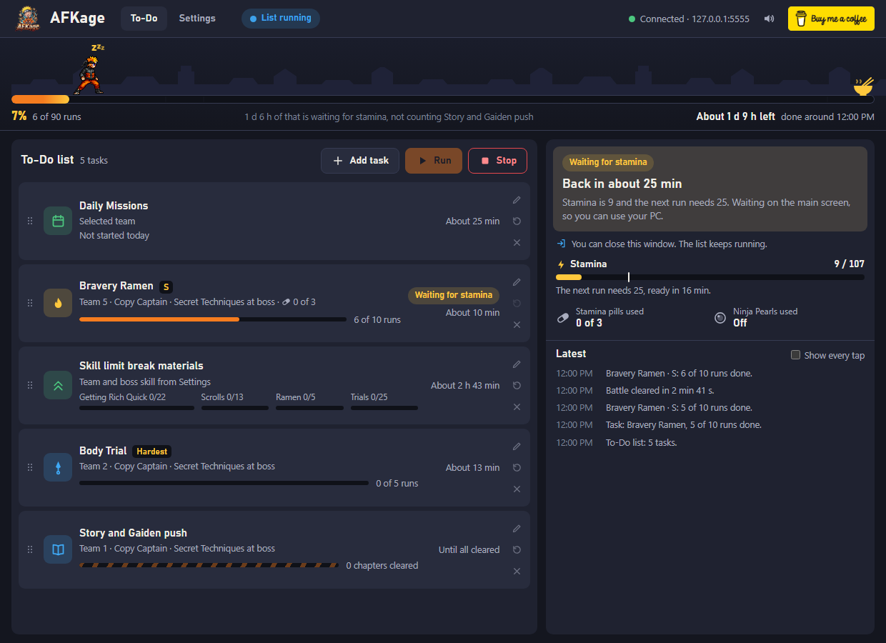

### When it stops

The right side says what happened and what to do next. Your list and every task's progress are saved. Fix what it says, then press **Run**.

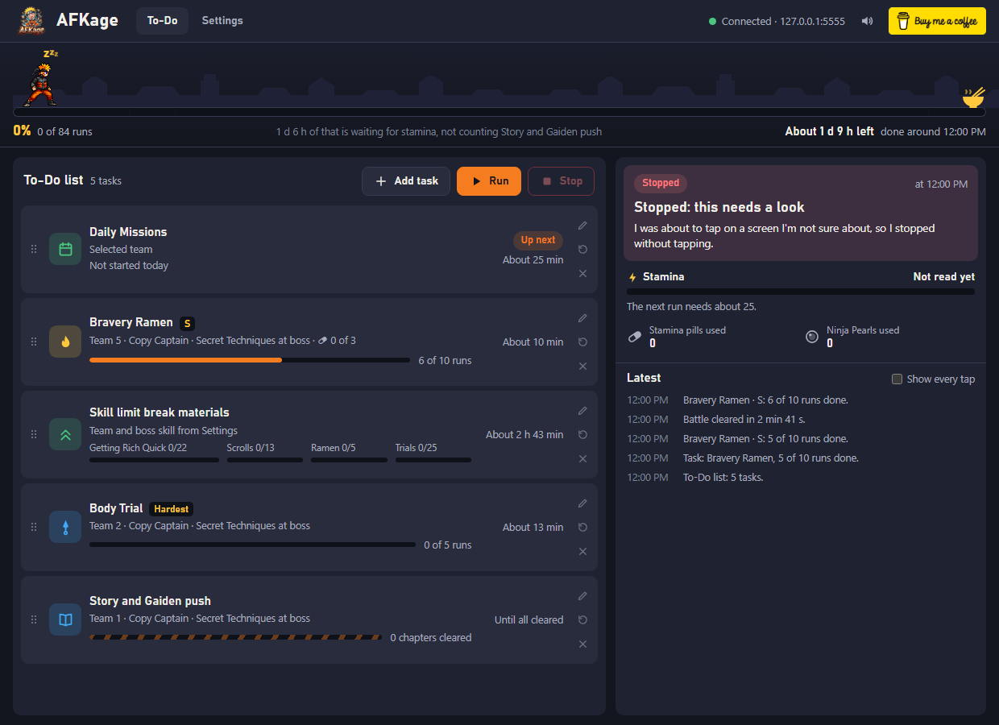

### Settings

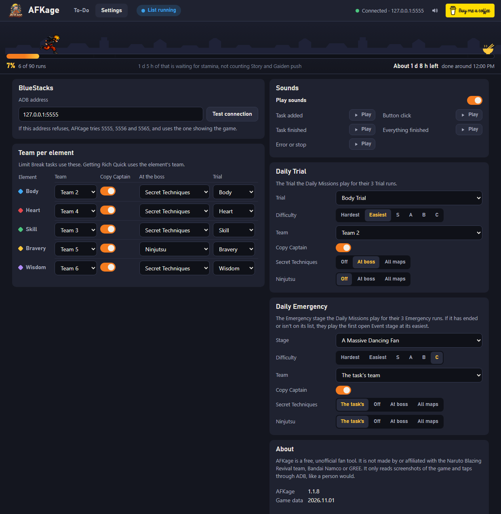

- **BlueStacks:** the ADB address, and a connection test. If the address refuses, AFKage tries 5555, 5556 and 5565, and uses the one showing the game. With two BlueStacks instances, copy the address from BlueStacks **Settings > Advanced**.
- **Team per element:** the team, Copy Captain, boss skill and Trial that Limit Break tasks use. Getting Rich Quick uses the element's team.
- **Sounds:** turn them off, or try each one. The speaker at the top of the window mutes them too.
- **Daily Trial:** the Trial, difficulty, team and battle settings for the Daily Missions' 3 Trial runs.
- **About:** your versions, What's new, **Check for updates**, and links for help.
- **Advanced:** the screen setup page. You shouldn't need it day to day.

### Updates

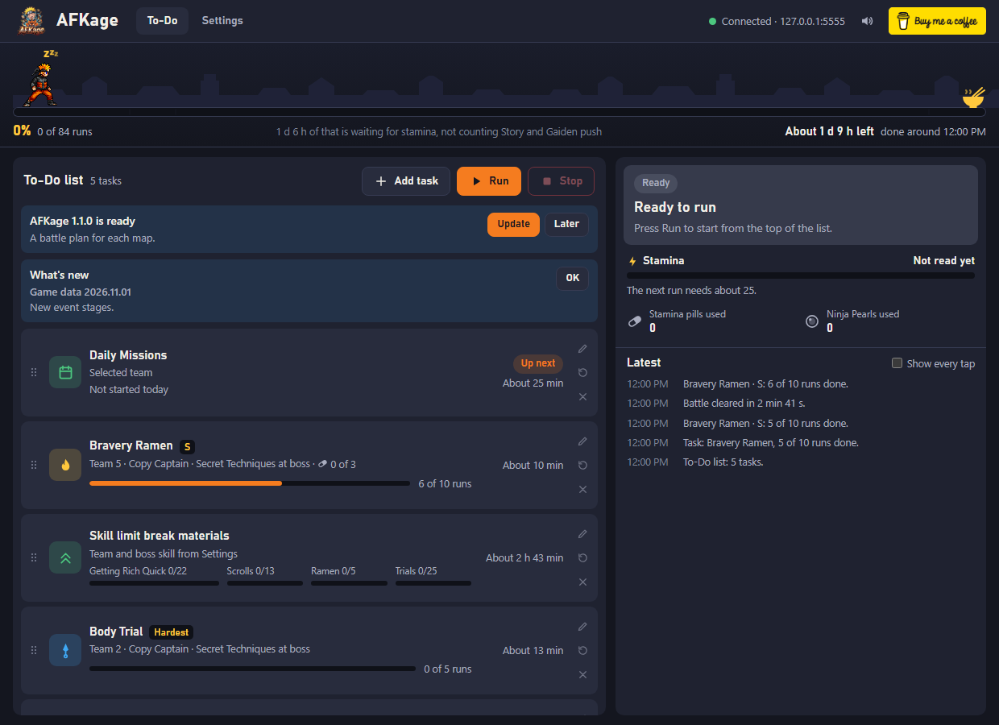

- **A new AFKage:** the window asks first. Press **Update** and it replaces itself and restarts. Stop the list first. **Later** asks again the next time AFKage starts.
- **New game data:** new stages and game patches arrive with no new download.
- **Each update** shows short What's new notes.
- **Bad game data:** if an update stops AFKage recognising the game, press **Roll back game data** in **Settings**.
- **Events that end:** a task shows when its event ends, such as **Ends in 4 days**. Once it has ended and its banner is gone, the task is skipped and the rest of the list carries on, with no update needed.

## Roadmap

### v1.1: battle plans

- **Ninja Road** is in: maps 1 to 15 on Auto, a plan per map, three teams told apart by their faces, Retreat and claim, and Road after Road.
- **A plan per map** for every task type: set Map 1, Map 2, Map 3 and Boss to off, Ninjutsu, Ninjutsu once, or Secret Technique.
- **Battle speed per task:** x1 to x4.

### v1.2

- **The swap leader trick with Copy Captain.**
- **Phantom Castle** when it returns.

### v2: Custom Manual

For Hard S, Impact, event stages and Ninja Road maps 16 to 20, which the game's Auto can't clear well. AFKage learns to read the battle first, then plays it from your own recording.

- **Record your own run:** play it once, and AFKage turns your touches into steps tied to the battle.
- **Replay it safely:** each step runs only when its moment shows, and AFKage stops if the battle goes differently.
- **Share it:** export a plan with its team, for others to import.

## FAQ

**Is it free?**
Yes.

**Can I get banned?**
It's possible. AFKage acts like a person tapping the screen and changes nothing in the game, but it's still automation. The revival's rules can change, so check them, and use it at your own risk.

**Does it need root, or change the game?**
No. It takes screenshots and taps through ADB. It doesn't inject code, modify the game or read memory.

**Does it work with other emulators, or other screen sizes?**
No. It needs BlueStacks 5 at 900 x 1600, because it recognises screens by matching images at that size.

**It says my screen isn't recognised.**
Check BlueStacks is at 900 x 1600 and the game is on its main screen. If it still isn't recognised, your game may be a different version. [Report a bug](../../issues/new/choose) with the saved screen.

**Can't connect to BlueStacks?**
Check BlueStacks is open and ADB is on in **Settings > Advanced**. Then copy the address shown there into AFKage **Settings**.

**Windows or my antivirus warned me about it.**
AFKage isn't signed with a paid certificate, and tools that control other apps can look suspicious to antivirus software. Download it only from this page's [Releases](../../releases/latest).

**Does it send anything anywhere?**
No. It only looks at this page's Releases for updates. Your settings, tasks and screenshots stay on your PC, in `%LOCALAPPDATA%\AFKage`.

**Can I close the window?**
Yes. The list keeps running. Open AFKage again to see it.

**Can I play the game while a list runs?**
No. AFKage needs the game to itself. Press **Stop** first.

**Why did my Ninja Road end at map 13?**
Every team was wiped there, so the game closed the Road. AFKage claimed the rewards from the maps it cleared, logged **Road 2 ended at map 13 (all teams wiped)**, and started the next Road if you asked for more. Maps past 12 or so need a stronger team or manual play, so set the maps to play to what your team clears, and leave the later ones out until the roadmap's Custom Manual gets there.

**How do I remove AFKage?**
Delete `AFKage.exe`, then delete the `%LOCALAPPDATA%\AFKage` folder.

**Where do I get help?**
Ask in [Discussions](../../discussions).

## Report a bug

Open a [GitHub Issue](../../issues/new/choose). The form asks for:

- your AFKage version, from **Settings > About**
- what happened
- a screenshot of the AFKage window
- a screenshot of the game screen it stopped on

Your player name and User ID show on some game screens, so crop or blur them first.

## Support AFKage

AFKage is free to download and use, but all rights are reserved. See [LICENSE](LICENSE).
